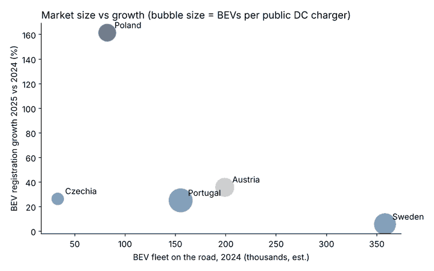

# Where should Fastned expand next? A market-entry case

**Recommendation: Fastned should enter Poland after Austria, starting on the Berlin–Poznań–Warsaw corridor.**

An independent consulting-style case study using public data. Fastned (Dutch fast-charging operator, 434 stations in 9 countries) targets 1,000 stations by 2030, so it needs new markets. Austria is already announced as the next one. This analysis asks: **which country after that?**

📊 **Slide deck:** [Fastned_Expansion_Case.pdf](Fastned_Expansion_Case.pdf)



## Approach
Four candidate markets (Poland, Czechia, Sweden, Portugal) are scored on five criteria, each scaled 0-1 and weighted:

| Criterion | Metric | Weight |
|---|---|---|
| Market size | Battery-electric cars on the road (2024) | 30% |
| Growth | BEV registration growth 2025 vs 2024 | 25% |
| Charging gap | BEVs per public DC charge point | 25% |
| Policy support | National EV incentives (1-3) | 10% |
| Network fit | Proximity to Fastned markets (1-3) | 10% |

A sensitivity test raises each weight by 50% to check whether the answer holds.

## Results
| Rank | Country | Score | Why |
|---|---|---|---|
| 1 | **Poland** | 0.59 | BEV sales +162% in 2025, strong purchase grant, borders Fastned Germany |
| 2 | Sweden | 0.54 | Largest EV fleet, but growth has slowed (+6%) |
| 3 | Portugal | 0.39 | Scarcest chargers, weak policy support |
| 4 | Czechia | 0.18 | Small market, relatively well served |

Poland stays first in 4 of 5 sensitivity tests. Sweden wins only if market size is weighted much more heavily.

## Recommendation
1. **Phase 1 (2027):** 5-8 stations on the A2 Berlin–Poznań–Warsaw corridor, extending Fastned's German network.
2. **Phase 2 (2028-29):** scale to 25-30 stations around Warsaw, Kraków, Wrocław and Gdańsk.
3. **Go/no-go gate:** revenue per station against Fastned's €350-400k guidance.

**Key risks:** small EV fleet today (0.4% of cars), dependence on the NaszEauto grant, local competition, grid-connection lead times.

## Run it
```bash
pip install -r requirements.txt
python analysis.py
```
Outputs the ranking, sensitivity table, `results.csv` and charts in `charts/`.

## Data and limitations
Sources are listed in [data/SOURCES.md](data/SOURCES.md) (ACEA, EAFO, Fastned investor releases). Data years differ (sales 2025, fleet 2024, chargers 2023), fleet sizes are estimates, and policy and network-fit scores are judgement calls. Site costs, grid capacity and competitor pipelines are not modelled.

*Independent student analysis based on public data; not affiliated with or endorsed by Fastned.*

---
Built by **Aafan Khan**, BSc Business Administration, University of Amsterdam · [LinkedIn](https://www.linkedin.com/in/aafan-khan)
